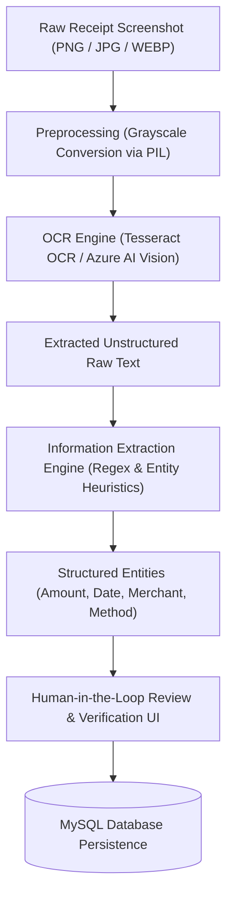

# ExpenseTrack – AI-900: Computer Vision & Knowledge-Based Systems

## 1. Executive Summary & AI-900 Mapping

The **Microsoft Certified: Azure AI Fundamentals (AI-900)** exam covers fundamental concepts of artificial intelligence, machine learning, computer vision, natural language processing (NLP), and responsible AI practices.

**ExpenseTrack** integrates two major AI-900 subdisciplines:
1. **Computer Vision & Optical Character Recognition (OCR):** Ingestion and reading of payment receipts and mobile screenshots.
2. **Knowledge-Based Expert Systems & Entity Recognition:** Rule-based heuristic extraction of structured financial entities and contextual spending advice.

---

## 2. Computer Vision Pipeline



### 2.1 Preprocessing:
Raw screenshot images vary in resolution and background color. The application converts uploaded images to single-channel 8-bit grayscale (`image.convert("L")`) using Pillow, enhancing edge contrast for the OCR engine.

### 2.2 Text Recognition:
- **Primary Engine:** Tesseract OCR (via `pytesseract`) running local optical character classification on character glyphs.
- **Enterprise Cloud Alternative:** Azure AI Vision Read API (`ImageAnalysisClient.analyze`), which performs deep-learning-based line and word recognition in cloud deployments.

---

## 3. Entity Extraction & Classification (NLP & Heuristics)

Once raw text is produced, an extraction module parses key financial entities:

### 3.1 Currency & Monetary Amount Recognition
Matches currency symbols (₹, INR, Rs) and transaction keywords (Total, Paid, Amt) followed by numeric tokens:
```python
r"(?:₹|rs\.?|inr|total|paid|amt|amount)\s*[:\-\s]?\s*([0-9]{1,3}(?:,[0-9]{3})*(?:\.[0-9]{1,2})?)"
```

### 3.2 Date Recognition
Handles multiple temporal formats (Indian standard `DD/MM/YYYY`, ISO `YYYY-MM-DD`, and natural language `DD Mon YYYY`):
```python
r"\b([0-3]?[0-9])[/\-\.]([0-1]?[0-9])[/\-\.](20[2-3][0-9])\b"
```

### 3.3 Merchant Recognition & Categorization
Identifies merchant names via UPI keywords (`"Paid to <Name>"`, `"To: <Name>"`) or known student merchant vocabularies (Swiggy, Zomato, Uber, Decathlon, Campus Canteen), and automatically infers the correct category.

---

## 4. Responsible AI Principles (AI-900 Core Framework)

| Principle | ExpenseTrack Implementation |
|-----------|-----------------------------|
| **Transparency** | The UI explicitly informs the student whether OCR extraction succeeded, produced partial text, or fell back to manual input. |
| **Reliability & Safety** | Never fabricates or hallucinates financial data if OCR fails; implements human-in-the-loop review. |
| **Privacy & Security** | Cryptographic SHA-256 duplicate detection; zero retention of sensitive authentication credentials (PINs, OTPs, CVVs). |
| **Accountability** | The user has final authority to modify, confirm, or discard extracted fields before saving to MySQL. |
| **Fairness** | Uniform deterministic budget alert thresholds applied equally to all student users without biased scoring models. |

