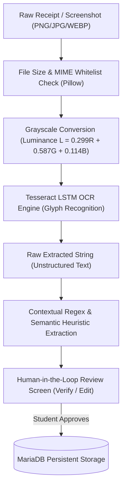
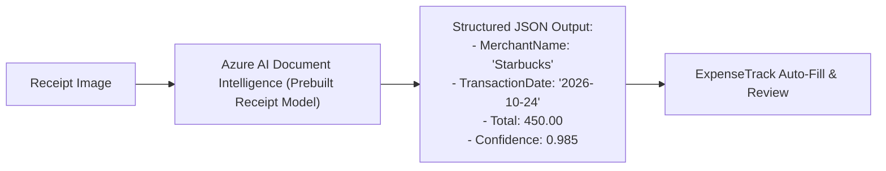

# ExpenseTrack: Microsoft Azure AI Fundamentals (AI-900) Viva Notes

**Subject:** Artificial Intelligence Fundamentals & Computer Vision (AI-900)  
**Project:** ExpenseTrack – Smart Student Expense Manager  
**Subsystems:** Computer Vision OCR Pipeline, Information Extraction Heuristics, Responsible AI Principles  

---

## 1. AI Taxonomy: AI vs. Machine Learning vs. Heuristic Parsing

In academic evaluations, candidates must clearly define where their application components sit within the Artificial Intelligence hierarchy:

```
+-------------------------------------------------------------------------+
|                  ARTIFICIAL INTELLIGENCE (Broad Field)                  |
|  Any technique that enables computers to mimic human cognition.        |
|                                                                         |
|     +-------------------------------------------------------------+     |
|     |            MACHINE LEARNING (Statistical Learning)         |     |
|     |  Algorithms trained on data (e.g., Tesseract LSTM OCR).     |     |
|     |                                                             |     |
|     |     +-------------------------------------------------+     |     |
|     |     |              DEEP LEARNING                      |     |     |
|     |     |  Multi-layered Neural Networks (CNNs & Transformers)| |     |
|     |     +-------------------------------------------------+     |     |
|     +-------------------------------------------------------------+     |
|                                                                         |
|     +-------------------------------------------------------------+     |
|     |       DETERMINISTIC HEURISTIC / EXPERT SYSTEMS              |     |
|     |  Explicit rule-based parsers, regex patterns & algorithms.  |     |
|     |  (ExpenseTrack Entity Extractor & Spending Insights).       |     |
|     +-------------------------------------------------------------+     |
+-------------------------------------------------------------------------+
```

### 1.1 Where ExpenseTrack Fits
1. **Perception Layer (Computer Vision / ML):** The transformation of raster pixel grids into recognized textual characters is performed by an OCR engine (**Tesseract**), which utilizes a Convolutional/LSTM (Long Short-Term Memory) Deep Neural Network trained on millions of typographical glyphs.
2. **Extraction Layer (Deterministic Rule-Based System):** Once raw string tokens are generated, ExpenseTrack applies contextual regex pattern matching and semantic heuristics (`services/ocr_service.py`) to classify tokens into financial entities (Amount, Date, Merchant, Payment Method).
3. **Reasoning Layer (Rule-Based Financial Intelligence):** The spending insights engine (`services/insight_service.py`) applies deterministic financial formulas rather than black-box statistical generation to ensure 100% mathematical accuracy.

---

## 2. Computer Vision: The OCR Image Processing Pipeline

The optical character recognition pipeline in `services/ocr_service.py` executes discrete computer vision transformations:



### 2.1 Technical Steps
1. **Image Ingestion & Format Validation:** The upload handler validates the binary header against allowed image MIME types (`image/png`, `image/jpeg`, `image/webp`).
2. **Grayscale Color Space Transformation:**
   ```python
   # Convert RGB (3 channels: Red, Green, Blue) to Luminance (1 channel: Grayscale)
   image = image.convert("L")
   ```
   *Why this matters:* Color information (e.g., a green PhonePe header or blue Google Pay banner) introduces background noise. Reducing the image to single-channel intensity simplifies edge detection and character thresholding.
3. **Character Recognition via LSTM:** Tesseract scans horizontal text lines, slices characters into feature vectors, and feeds them into a bidirectional LSTM neural network to predict character sequences with probabilistic confidence scores.
4. **Entity Normalization:** Converts extracted date strings into standard ISO 8601 format (`YYYY-MM-DD`) and monetary amounts into valid IEEE floating-point representations prior to database persistence.

---

## 3. Heuristic Regex Parsing vs. Machine Learning NER

| Dimension | Rule-Based Regex (ExpenseTrack) | Machine Learning NER (Named Entity Recognition) |
| :--- | :--- | :--- |
| **Working Principle** | Explicit regular expressions scanning for currency symbols (`₹`, `Rs`, `Total:`) and date formats (`DD/MM/YYYY`). | Statistical tokens processed through pre-trained Transformer models (e.g., SpaCy, BERT, LayoutLM). |
| **Compute Overhead** | Extremely lightweight ($<5\text{ms}$ CPU time); runs on any minimal virtual machine. | Heavy ($>500\text{MB}$ memory footprint; requires significant CPU or dedicated GPU). |
| **Explainability** | **100% Deterministic:** You can point directly to the regex pattern that matched the merchant or amount. | **Probabilistic Black Box:** Difficult to explain why a specific weight vector made a decision. |
| **Error Modes** | Fails when receipts deviate drastically from anticipated lexical patterns. | May hallucinate or misclassify entities when out-of-domain noise is present. |
| **Maintenance** | Developers easily add or update merchant aliases in code without retraining. | Requires gathering labeled datasets, retraining models, and evaluating F1-scores. |

---

## 4. Microsoft Responsible AI Framework (6 Principles)

In the AI-900 curriculum, Microsoft outlines six core principles for designing ethical, reliable artificial intelligence systems. Here is how ExpenseTrack adheres to each:

### 4.1 Fairness
- **Principle:** AI systems should treat all people fairly without algorithmic bias.
- **Implementation:** Financial recommendations are based strictly on mathematical expenditure percentages (e.g., spending $>35\%$ of budget on Food), not on socioeconomic or demographic user attributes.

### 4.2 Reliability & Safety
- **Principle:** AI systems should operate reliably, safely, and consistently under diverse conditions.
- **Implementation:** When an external dependency (Tesseract binary) is missing, ExpenseTrack does not crash with a 500 server error; it activates a resilient **graceful fallback** informing the student to review their receipt details manually.

### 4.3 Privacy & Security
- **Principle:** AI systems should be secure and respect data privacy.
- **Implementation:** Payment screenshots are processed locally on-premise without transmitting student financial records to third-party public cloud APIs. ExpenseTrack explicitly refuses to scan or store UPI PINs, CVVs, or bank passwords.

### 4.4 Inclusiveness
- **Principle:** AI systems should empower everyone and engage people.
- **Implementation:** The user interface features high-contrast accessible typography, intuitive icon indicators, and mobile-responsive viewport scaling for accessibility across all student hardware.

### 4.5 Transparency
- **Principle:** AI systems should be understandable; users must know how decisions are made.
- **Implementation:** The system displays the extracted OCR text and extracted fields on a staging screen with a clear status message (`ocr_status = "success"` or `"fallback"`). It never fabricates an amount or pretends extraction was successful when it failed.

### 4.6 Accountability
- **Principle:** People must be accountable for AI systems and outcomes.
- **Implementation:** **Human-in-the-Loop Pattern.** The application requires explicit human verification before any extracted OCR data can modify database state. The student remains the ultimate decision-maker.

---

## 5. Enterprise Cloud AI Evolution: Azure AI Document Intelligence

While ExpenseTrack employs local Tesseract OCR with heuristic extraction for offline reproducibility, a production cloud deployment would integrate **Azure AI Document Intelligence** (formerly Azure Form Recognizer):



### Advantages of Azure AI Document Intelligence
1. **Prebuilt Receipt Model:** Pre-trained on millions of global invoices, receipts, and restaurant bills in 70+ languages.
2. **Key-Value Pair Understanding:** Understands multi-line invoice tables, tax breakdowns (CGST/SGST), and tip amounts natively without manual regex programming.
3. **Bounding Box Metadata:** Returns precise pixel coordinates for every detected word, enabling visual highlight overlays on the original receipt image.

---

## 6. AI-900 Viva Questions & Concise Answers (10 Questions)

**Q1: What is the fundamental difference between Artificial Intelligence and Machine Learning?**  
*Answer:* Artificial Intelligence is the overarching discipline of creating systems capable of performing tasks that typically require human intelligence. Machine Learning is a specific subset of AI where algorithms learn patterns from training data to make predictions or decisions without being explicitly programmed for every rule.

**Q2: What is Computer Vision?**  
*Answer:* Computer Vision is a subfield of AI that enables computer systems to interpret, process, and understand visual information from digital images or videos (such as object detection, image classification, and optical character recognition).

**Q3: How does Optical Character Recognition (OCR) work inside Tesseract?**  
*Answer:* Tesseract converts the raster image to binary/grayscale, segments the page into text blocks and lines, extracts character features, and uses a deep LSTM (Long Short-Term Memory) neural network to predict character sequences based on linguistic language models.

**Q4: Why does ExpenseTrack convert receipt images to grayscale (`image.convert('L')`) before running OCR?**  
*Answer:* Grayscale conversion removes irrelevant color channel variations (like background color branding on UPI apps) and reduces the image to a single luminance channel, which sharpens edge contrast and significantly improves character recognition accuracy.

**Q5: What is the difference between OCR and Natural Language Processing (NLP)?**  
*Answer:* OCR is a computer vision task that converts visual image pixels into raw digital text strings. NLP is a computational linguistics task that takes those raw text strings and understands their grammatical meaning, entities, sentiment, and context.

**Q6: What is the Human-in-the-Loop design pattern and why is it essential for financial receipt scanning?**  
*Answer:* Human-in-the-Loop means an automated AI process produces a draft or candidate result, but requires a human user to review, edit, and confirm the output before it becomes permanent. In financial systems, OCR errors (such as misreading ₹100 as ₹1000) could distort budgets; human verification eliminates financial data corruption.

**Q7: What is Responsible AI? Name three of Microsoft's six Responsible AI principles.**  
*Answer:* Responsible AI is a framework for developing artificial intelligence systems ethically, safely, and transparently. Three core principles are:  
1. **Transparency** (users understand how system decisions are made),  
2. **Privacy & Security** (user data is protected from exposure), and  
3. **Accountability** (humans retain responsibility and oversight for AI outcomes).

**Q8: Why does ExpenseTrack calculate SHA-256 hashes of uploaded receipt images?**  
*Answer:* To prevent duplicate image submissions. By calculating the cryptographic hash of the image bytes, the system can instantly detect if a student accidentally uploads the same payment screenshot twice, saving storage space and preventing duplicate expense records.

**Q9: Why did you use deterministic rules instead of an LLM (like GPT-4) for the spending insights engine?**  
*Answer:* Financial calculations require 100% mathematical precision and reproducibility. LLMs are probabilistic token predictors that can suffer from numerical hallucinations and high API latency. Deterministic rule-based algorithms guarantee exact calculations, instant response times, zero operational cost, and full explainability.

**Q10: What are the primary limitations of local Tesseract OCR compared to cloud models like Azure AI Document Intelligence?**  
*Answer:* Local Tesseract relies primarily on font glyph recognition and lacks spatial awareness of complex multi-column table layouts. Cloud services like Azure AI Document Intelligence use multi-modal transformers that understand document geometry, key-value semantic relationships, and low-light mobile camera distortions with significantly higher accuracy.

