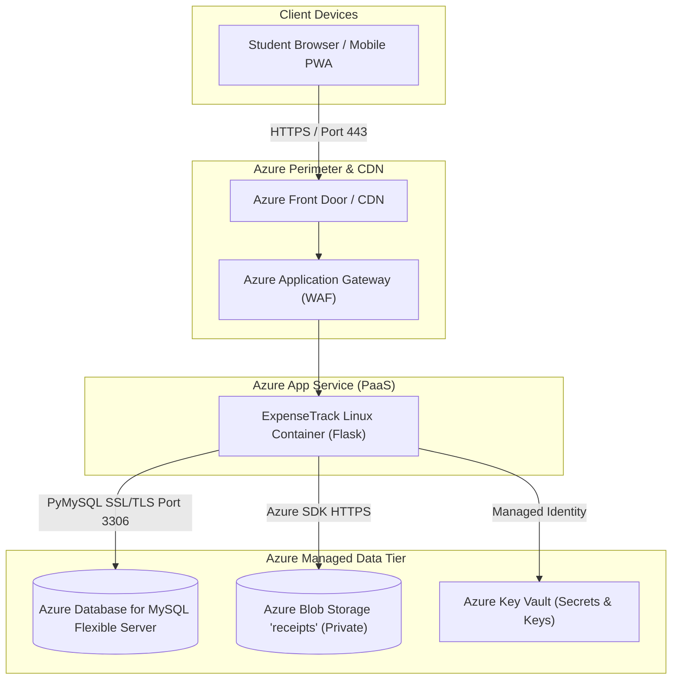

# ExpenseTrack: Microsoft Azure Data Fundamentals (DP-900) Viva Notes

**Subject:** Cloud Data Architecture & Microsoft Azure Data Fundamentals (DP-900)  
**Project:** ExpenseTrack – Smart Student Expense Manager  
**Cloud Services Evaluated:** Azure Database for MySQL / Azure SQL Database, Azure Blob Storage, Azure Key Vault  

---

## 1. Relational vs. Non-Relational Data & Workload Classification

In cloud data architecture (DP-900 curriculum), data is categorized into three fundamental structures:

| Data Type | Definition | ExpenseTrack Implementation | Cloud Technology |
| :--- | :--- | :--- | :--- |
| **Structured Data** | Formally defined schema with tables, columns, rows, and mathematical relations. Adheres to strict schemas and ACID principles. | User accounts, transactions, monetary amounts, budget limits, and category lookups. | **Azure Database for MySQL** / **Azure SQL Database** |
| **Semi-Structured Data** | Non-tabular data containing internal tags or markers (JSON, XML, YAML). Schema is dynamic or flexible. | Raw OCR extraction payload, bounding boxes, diagnostic audit logs, and API request metadata. | **Azure Cosmos DB** (NoSQL / Document store) |
| **Unstructured Data** | Binary data with no conceptual schema (media, audio, video, raw document images). | Uploaded payment screenshots, UPI receipt receipts, and merchant PDF invoices. | **Azure Blob Storage** (Object storage) |

### 1.1 Workload Classification: OLTP vs. OLAP
- **OLTP (Online Transaction Processing):** ExpenseTrack is fundamentally an **OLTP workload**. It processes high-frequency, low-latency, mission-critical reads and writes (e.g., logging a ₹50 transaction, updating budget usage, verifying session authentication). InnoDB row-level locking ensures concurrency without locking the entire table.
- **OLAP (Online Analytical Processing):** Long-term historical analysis (e.g., multi-year spending patterns across 50,000 university students) would be offloaded to an OLAP cloud data warehouse (such as **Azure Synapse Analytics**) via ETL/ELT pipelines using **Azure Data Factory**.

---

## 2. Cloud Storage Architecture: Azure Blob Storage

```
+-------------------------------------------------------------------------+
|                  AZURE STORAGE ACCOUNT (General Purpose v2)              |
|                                                                         |
|  Container: "receipts" (Private Access Level - No Public Anonymous Read) |
|                                                                         |
|     +----------------------------+   +----------------------------+     |
|     | Block Blob:                |   | Block Blob:                |     |
|     | 4c9b2e...b3.png (Hot Tier) |   | 8f12a1...c0.jpg (Hot Tier) |     |
|     +----------------------------+   +----------------------------+     |
+-------------------------------------------------------------------------+
```

### 2.1 Blob Architecture & Types
- **Block Blobs:** Used by ExpenseTrack. Composed of blocks up to 4000 MiB; optimized for streaming and uploading discrete binary files (receipt images, photos).
- **Append Blobs:** Optimized for append-only operations (ideal for distributed application audit logging).
- **Page Blobs:** Optimized for random read/write operations (used as VHD disks for Azure Virtual Machines).

### 2.2 Storage Access Tiers
1. **Hot Tier:** Optimized for frequently accessed data (used by ExpenseTrack for newly uploaded receipts during the active billing month).
2. **Cool Tier:** Lower storage cost, higher access cost; optimized for data stored for at least 30 days (e.g., receipts from previous semesters).
3. **Cold Tier:** Optimized for data accessed infrequently with lower storage costs (stored for at least 90 days).
4. **Archive Tier:** Lowest storage cost, highest latency (hours to rehydrate); suitable for multi-year compliance archiving of tax or university fee records.

### 2.3 Redundancy & High Availability Options
- **LRS (Locally Redundant Storage):** Replicates data synchronously 3 times within a single physical data center. Lowest cost; guards against disk or rack failure.
- **ZRS (Zone-Redundant Storage):** Replicates data synchronously across 3 Azure Availability Zones within a single region. Protects against entire datacenter outages.
- **GRS (Geo-Redundant Storage):** Replicates 3 times in the primary region, then asynchronously replicates 3 times to a paired secondary region hundreds of kilometers away (total 6 copies). Protects against regional natural disasters.

---

## 3. Relational Cloud Database: Azure Database for MySQL

ExpenseTrack's relational schema runs locally on a portable MariaDB/MySQL engine and is architected for zero-code-change migration to **Azure Database for MySQL Flexible Server**.

### 3.1 Flexible Server Features
- **Zone-Redundant High Availability:** Automatic failover across availability zones with zero data loss ($RPO = 0$).
- **Automated Backups & Point-in-Time Restore (PITR):** Continuous transaction log backups allow rolling back the database to any exact second within a 35-day retention window.
- **Data Encryption at Rest:** Automated Transparent Data Encryption (TDE) with service-managed keys or customer-managed keys (CMK) via Azure Key Vault.
- **Scale-Up / Scale-Down Compute:** Dynamic burstable, general-purpose, or memory-optimized vCore scaling.

---

## 4. Cloud Migration Roadmap

The following diagram illustrates how the local ExpenseTrack application migrates into a production Microsoft Azure cloud environment.



### 4.1 Step-by-Step Migration Strategy
1. **Application Layer:** Containerize the Flask application via Docker and deploy to **Azure App Service (Linux Web App)**.
2. **Database Migration:** Use **Azure Database Migration Service (DMS)** to execute an online, zero-downtime replication of the local `expensetrack` database into **Azure Database for MySQL (Flexible Server)**.
3. **Binary Storage:** Export the local `uploads/receipts/` directory into Azure Blob Storage using `azcopy copy` or the Azure Storage REST API.
4. **Secret Management:** Eliminate `.env` files by storing database passwords and connection strings in **Azure Key Vault**, retrieved at container startup using **Azure Managed Identities** (RBAC).

---

## 5. Architectural Integrity & Transparency Disclosure

> [!IMPORTANT]
> **Academic Integrity Statement:**  
> In the current viva demonstration, ExpenseTrack is running against a local MariaDB/MySQL process (`127.0.0.1:3306`) and storing receipt files in the local private vault directory (`uploads/receipts/`).  
> The codebase in `services/azure_storage.py` and `config.py` contains production-ready Azure Blob Storage SDK routines (`BlobServiceClient.from_connection_string`). If Azure connection credentials are provided via environment variables, the system uploads directly to the cloud container; otherwise, it activates its verified local fallback mechanism. We do **not** claim a billable Azure cloud subscription is actively deployed for this local examination.

---

## 6. DP-900 Viva Questions & Concise Answers (10 Questions)

**Q1: What is the core difference between Azure SQL Database and Azure Database for MySQL?**  
*Answer:* Azure SQL Database is a managed relational database service based on the Microsoft SQL Server (T-SQL) engine. Azure Database for MySQL is a fully managed community MySQL (InnoDB) database service. ExpenseTrack uses MySQL dialect and PyMySQL drivers, making Azure Database for MySQL Flexible Server the direct target.

**Q2: What is the purpose of Azure Blob Storage in ExpenseTrack?**  
*Answer:* Azure Blob Storage provides cost-effective, highly scalable, and durable object storage for unstructured data (receipt images, payment screenshots). Storing large binary files in Blob storage prevents database bloat and preserves relational database performance.

**Q3: Explain the difference between Structured, Semi-Structured, and Unstructured data.**  
*Answer:* Structured data adheres to a rigid schema of rows and columns (e.g., MySQL `expenses`). Semi-structured data contains organizational markers like tags or key-value pairs without a rigid schema (e.g., JSON OCR results). Unstructured data has no predefined data model (e.g., PNG/JPEG image files).

**Q4: What is an OLTP workload and how does ExpenseTrack qualify?**  
*Answer:* OLTP (Online Transaction Processing) workloads involve processing high-concurrency, short, real-time database transactions with strict ACID guarantees. ExpenseTrack is an OLTP system because users continuously insert, update, and query current personal spending records with millisecond latency.

**Q5: What are the access tiers in Azure Blob Storage and when would you use each?**  
*Answer:*  
- **Hot Tier:** For frequently accessed data (current month's receipts).  
- **Cool Tier:** Lower storage price, higher access cost, minimum 30-day retention (past semester records).  
- **Cold Tier:** Infrequent access, minimum 90-day retention.  
- **Archive Tier:** Lowest storage cost, high retrieval latency and cost, minimum 180-day retention (regulatory financial audit archives).

**Q6: What is the difference between LRS (Locally Redundant) and GRS (Geo-Redundant) storage?**  
*Answer:* LRS maintains three synchronous replicas within a single data center in the primary region (protects against single hardware failure). GRS replicates three times in the primary region and asynchronously copies data three times to a secondary paired region hundreds of miles away (protects against catastrophic regional disaster).

**Q7: How does Point-in-Time Restore (PITR) work in Azure Database for MySQL?**  
*Answer:* The service takes automated full backups weekly, differential backups twice daily, and continuously archives transaction logs (`binlogs`) every five minutes. To restore, Azure provisions a new server and replays the transaction logs up to the exact requested minute.

**Q8: Why shouldn't images be stored as BLOB columns directly inside a relational database table?**  
*Answer:* Storing multi-megabyte binary images directly in relational tables rapidly inflates the database file size, degrades buffer pool cache hit ratios, slows down index scans, and makes database backups and replication significantly more expensive. Offloading images to Blob storage and keeping only the URL or reference path in the database is the cloud best practice.

**Q9: What is Azure Key Vault and how does it improve cloud security?**  
*Answer:* Azure Key Vault is a cloud hardware security module (HSM) service for securely storing API keys, database connection strings, passwords, and cryptographic certificates. It eliminates hardcoded secrets in source code and supports access policies via Azure Entra ID (formerly Azure Active Directory).

**Q10: What is Shared Access Signature (SAS) in Azure Storage?**  
*Answer:* A SAS token is a signed URI that grants delegated, time-limited, and permission-restricted access (e.g., Read-Only for 15 minutes) to private storage blobs without exposing the storage account master keys.

