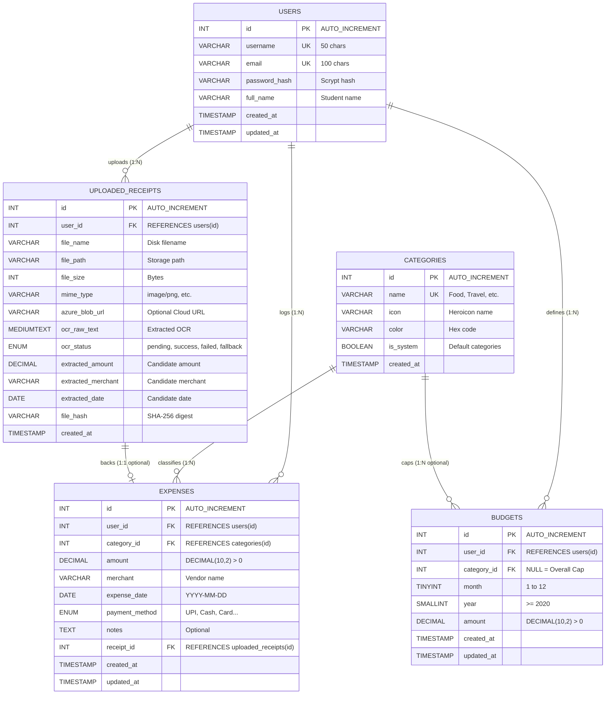

# ExpenseTrack: Relational Database Management System (RDBMS) Viva Notes

**Subject:** Database Management Systems (DBMS / RDBMS)  
**Database Name:** `expensetrack`  
**Engine & Standard:** MariaDB 10.11 / MySQL 8.0+ (InnoDB Storage Engine, UTF8MB4)

---

## 1. Fundamentals of RDBMS & Technology Choice

### 1.1 What is an RDBMS?
A **Relational Database Management System (RDBMS)** is a data management system based on E.F. Codd’s relational model. Data is stored in structured two-dimensional tables (relations) comprising rows (tuples/records) and columns (attributes/fields). Relationships between tables are maintained through primary and foreign keys.

### 1.2 Why MySQL / MariaDB for ExpenseTrack?
1. **ACID Compliance:** The default storage engine, **InnoDB**, provides full Atomicity, Consistency, Isolation, and Durability guarantees essential for financial transactions.
2. **Fixed-Point Decimal Precision:** Provides `DECIMAL(10,2)` data types to prevent binary floating-point rounding inaccuracies inherent in IEEE 754 representations (e.g., $0.1 + 0.2 \neq 0.3$).
3. **Declarative Integrity Constraints:** Supports `FOREIGN KEY`, `CHECK`, `UNIQUE`, and `NOT NULL` constraints directly at the database engine level.
4. **B-Tree Indexing:** Enables $O(\log N)$ lookup performance for transaction search and monthly date ranges.

---

## 2. Relational Schema & Entity-Relationship (ER) Model

### 2.1 Entity-Relationship (ER) Diagram



---

## 3. Database Normalization Analysis

ExpenseTrack is strictly normalized up to **Third Normal Form (3NF)** to eliminate data redundancy and modification anomalies.

### 3.1 First Normal Form (1NF)
- **Criterion:** All attributes are atomic (no repeating groups, multi-valued attributes, or comma-separated lists).
- **Compliance:**
  - Phone numbers or multiple payment methods are not packed into single strings.
  - Payment modes use single atomic `ENUM('UPI', 'Cash', 'Credit Card', 'Debit Card', 'Net Banking', 'Other')`.
  - Every table possesses an unambiguous atomic primary key (`id`).

### 3.2 Second Normal Form (2NF)
- **Criterion:** Must be in 1NF and have **no partial functional dependencies** (every non-key attribute must depend fully on the primary key, not a subset of a composite candidate key).
- **Compliance:**
  - All entities utilize surrogate single-column primary keys (`id INT AUTO_INCREMENT`).
  - In `budgets`, although the composite candidate key is `(user_id, category_id, month, year)`, all attributes like `amount` depend on the specific user, specific category, and specific billing period. There are no partial dependencies on only `user_id`.

### 3.3 Third Normal Form (3NF)
- **Criterion:** Must be in 2NF and have **no transitive functional dependencies** ($X \to Y$ where $Y$ is a non-prime attribute and $X$ is not a superkey).
- **Compliance:**
  - In the unnormalized state, someone might store `category_name`, `category_icon`, and `category_color` directly inside the `expenses` table.
  - In such an anti-pattern: $\text{expense\_id} \to \text{category\_id} \to \text{category\_name}$ creates an update anomaly (changing "Food" to "Dining" would require updating thousands of expense rows).
  - ExpenseTrack abstracts category metadata into a separate `categories` relation. `expenses` holds only the foreign key `category_id`.
  - Non-prime attributes in `expenses` (`amount`, `merchant`, `expense_date`) depend *only* on the primary key `id`.

---

## 4. Integrity Constraints & Referential Actions

| Constraint Type | Table | Definition / Rule | Real-World Purpose |
| :--- | :--- | :--- | :--- |
| **PRIMARY KEY** | All tables | `PRIMARY KEY (id)` | Ensures entity uniqueness and establishes clustered index. |
| **FOREIGN KEY (CASCADE)** | `expenses`, `budgets`, `receipts` | `FOREIGN KEY (user_id) REFERENCES users(id) ON DELETE CASCADE` | GDPR / Privacy compliance: Deleting a student account automatically purges all their financial data. |
| **FOREIGN KEY (RESTRICT)** | `expenses` | `FOREIGN KEY (category_id) REFERENCES categories(id) ON DELETE RESTRICT` | Prevents orphan records: System cannot delete a category if transactions currently reference it. |
| **FOREIGN KEY (SET NULL)** | `expenses` | `FOREIGN KEY (receipt_id) REFERENCES uploaded_receipts(id) ON DELETE SET NULL` | If an uploaded receipt image is purged, the financial expense entry remains intact with `receipt_id = NULL`. |
| **UNIQUE KEY** | `users` | `UNIQUE KEY (username)`, `UNIQUE KEY (email)` | Prevents duplicate user registrations. |
| **CHECK CONSTRAINT** | `expenses` | `CHECK (amount > 0.00)` | Enforces positive monetary expenditure; blocks negative or zero inputs at the engine level. |
| **CHECK CONSTRAINT** | `budgets` | `CHECK (month BETWEEN 1 AND 12)` | Guards against invalid calendar month indices. |

---

## 5. Core SQL Queries in ExpenseTrack

### 5.1 Expense Creation (DML)
```sql
INSERT INTO expenses (
    user_id, category_id, amount, merchant, expense_date, payment_method, notes
) VALUES (
    1, 2, 280.00, 'Campus Book Depot', '2026-10-29', 'UPI', 'Semester 3 Algorithms'
);
```

### 5.2 Monthly Total Spending Aggregation
Computes total expenditure for user `1` for the current calendar month:
```sql
SELECT 
    COALESCE(SUM(amount), 0.00) AS total_spending,
    COUNT(id) AS transaction_count
FROM expenses
WHERE user_id = 1
  AND expense_date >= '2026-10-01'
  AND expense_date <= '2026-10-31';
```

### 5.3 Spending by Category with INNER JOIN
Aggregates category totals, calculates percentages, and joins metadata for Chart.js doughnut rendering:
```sql
SELECT 
    c.id AS category_id,
    c.name AS category_name,
    c.color AS category_color,
    c.icon AS category_icon,
    COALESCE(SUM(e.amount), 0.00) AS total_spent,
    COUNT(e.id) AS transaction_count
FROM categories c
INNER JOIN expenses e ON e.category_id = c.id
WHERE e.user_id = 1
  AND e.expense_date BETWEEN '2026-10-01' AND '2026-10-31'
GROUP BY c.id, c.name, c.color, c.icon
ORDER BY total_spent DESC;
```

### 5.4 Monthly Budget Utilization (Subquery & Outer Aggregation)
Calculates overall monthly ceiling vs total expenditure to drive the dashboard progress bar:
```sql
SELECT 
    b.amount AS monthly_cap,
    COALESCE(spent.total, 0.00) AS total_spent,
    (b.amount - COALESCE(spent.total, 0.00)) AS remaining_allowance,
    ROUND((COALESCE(spent.total, 0.00) / b.amount) * 100, 1) AS utilization_percentage
FROM budgets b
LEFT JOIN (
    SELECT user_id, SUM(amount) AS total
    FROM expenses
    WHERE user_id = 1
      AND expense_date BETWEEN '2026-10-01' AND '2026-10-31'
    GROUP BY user_id
) spent ON spent.user_id = b.user_id
WHERE b.user_id = 1
  AND b.category_id IS NULL
  AND b.month = 10
  AND b.year = 2026;
```

### 5.5 Multi-Month Spending Trend (GROUP BY Date Functions)
Returns spending across the past 6 calendar cycles for the dashboard trend chart:
```sql
SELECT 
    DATE_FORMAT(expense_date, '%Y-%m') AS billing_cycle,
    DATE_FORMAT(expense_date, '%b %Y') AS cycle_label,
    SUM(amount) AS total_spent
FROM expenses
WHERE user_id = 1
  AND expense_date >= DATE_SUB('2026-10-01', INTERVAL 5 MONTH)
GROUP BY DATE_FORMAT(expense_date, '%Y-%m'), DATE_FORMAT(expense_date, '%b %Y')
ORDER BY billing_cycle ASC;
```

---

## 6. Database Transactions & ACID Guarantees

In ExpenseTrack, multi-step operations (such as converting an uploaded receipt into an expense and updating the receipt's processing state) are executed inside an **ACID Transaction**:

```python
connection = get_db_connection()
try:
    with connection.cursor() as cursor:
        # Step 1: Insert expense record
        cursor.execute("""
            INSERT INTO expenses (user_id, category_id, amount, merchant, expense_date, receipt_id)
            VALUES (%s, %s, %s, %s, %s, %s)
        """, (user_id, cat_id, amount, merchant, exp_date, receipt_id))
        
        # Step 2: Mark receipt status as verified
        cursor.execute("""
            UPDATE uploaded_receipts
            SET ocr_status = 'success'
            WHERE id = %s AND user_id = %s
        """, (receipt_id, user_id))
        
    connection.commit()  # Atomicity & Durability
except Exception as ex:
    connection.rollback() # Consistency preserved
    raise ex
finally:
    connection.close()
```

- **Atomicity:** Both queries succeed together, or neither takes effect.
- **Consistency:** Database transitions from one valid state to another without violating CHECK or FK constraints.
- **Isolation:** InnoDB's Repeatable Read isolation level ensures concurrent transactions cannot view uncommitted changes (dirty reads).
- **Durability:** Committed changes survive crashes by being written to the InnoDB Redo Log (`ib_logfile`).

---

## 7. SQL Injection Prevention & Parameterization

### Vulnerable Dynamic Construction (ANTI-PATTERN)
```sql
-- DANGEROUS: Direct string concatenation allows SQL Injection
query = f"SELECT * FROM expenses WHERE user_id = {user_id} AND merchant = '{search_term}'"
```
If `search_term` is `' OR '1'='1`, an attacker extracts all transactions belonging to all users.

### Parameterized Prepared Queries in ExpenseTrack (SECURE)
```python
# SAFE: PyMySQL protocol compiles query plan before data binding
cursor.execute(
    "SELECT * FROM expenses WHERE user_id = %s AND merchant LIKE %s",
    (user_id, f"%{search_term}%")
)
```
The database engine treats user input strictly as literal values, never as executable SQL instructions.

---

## 8. Comprehensive RDBMS Viva Q&A (15 Questions)

**Q1: What is the difference between a Primary Key and a Unique Key?**  
*Answer:* A Primary Key uniquely identifies a record and **cannot contain NULL values** (only one PK per table). A Unique Key also enforces distinctness but **permits NULL values** (MySQL allows multiple NULLs in unique columns) and a table may contain multiple unique keys.

**Q2: What is the difference between TRUNCATE and DELETE?**  
*Answer:* `DELETE` is a DML command that removes rows one by one, logs row deletions in the transaction log, and fires triggers. `TRUNCATE` is a DDL command that deallocates entire data pages, resets the `AUTO_INCREMENT` counter, cannot be rolled back easily in some engines, and does not fire triggers.

**Q3: Why did you use `DECIMAL(10,2)` instead of `FLOAT` or `DOUBLE` for monetary amounts?**  
*Answer:* `FLOAT` and `DOUBLE` are approximate numeric types stored in IEEE 754 binary floating-point format, leading to binary rounding errors (e.g., $0.7 + 0.1 = 0.7999999999999999$). `DECIMAL` is an exact fixed-point representation stored as packed decimal digits, guaranteeing zero penny-rounding loss.

**Q4: Explain Referential Integrity and give an example from ExpenseTrack.**  
*Answer:* Referential integrity ensures that foreign key references always point to valid primary key records. In ExpenseTrack, `expenses.category_id` references `categories.id`. If a user attempts to insert an expense with `category_id = 999` (which doesn't exist), the engine rejects the write with error code 1452.

**Q5: What is the difference between `ON DELETE CASCADE` and `ON DELETE SET NULL`?**  
*Answer:* `ON DELETE CASCADE` deletes dependent child rows when the parent is deleted (e.g., deleting a user deletes their expenses). `ON DELETE SET NULL` sets the child’s foreign key column to NULL while retaining the child row (e.g., deleting a receipt image sets `expenses.receipt_id = NULL`, preserving the financial record).

**Q6: What is a Clustered Index versus a Secondary Index in MySQL InnoDB?**  
*Answer:* The Clustered Index stores the actual row data directly inside the leaf nodes of the B+Tree (InnoDB always clusters data by the Primary Key `id`). A Secondary Index stores only the indexed column values and a pointer to the Primary Key.

**Q7: Why is `WHERE` different from `HAVING`?**  
*Answer:* `WHERE` filters individual rows **before** any aggregation (`GROUP BY`) is applied. `HAVING` filters aggregated groups **after** aggregate functions like `SUM()` or `COUNT()` have been calculated.

**Q8: Explain 1NF, 2NF, and 3NF in one sentence each.**  
*Answer:*  
- 1NF: All attribute values must be atomic with no repeating groups.  
- 2NF: The table must be in 1NF and have no partial dependencies on composite keys.  
- 3NF: The table must be in 2NF and have no transitive dependencies between non-key columns.

**Q9: What happens when an index is added to a table? What are the tradeoffs?**  
*Answer:* An index creates a B+Tree data structure that speeds up `SELECT`, `WHERE`, `JOIN`, and `ORDER BY` operations from $O(N)$ full table scans to $O(\log N)$ binary searches. The tradeoff is increased disk usage and slower `INSERT`, `UPDATE`, and `DELETE` operations because the index trees must be balanced on every write.

**Q10: What is a Dirty Read and how does InnoDB prevent it?**  
*Answer:* A dirty read occurs when Transaction A reads data modified by Transaction B before Transaction B has committed. InnoDB prevents dirty reads using Multi-Version Concurrency Control (MVCC) and the Read Committed / Repeatable Read isolation levels.

**Q11: Why is parameterized SQL effective against SQL Injection?**  
*Answer:* Parameterization separates the SQL query logic from user data. The database parser analyzes and compiles the SQL syntax structure first. When parameters are subsequently bound, they are treated purely as literal string/numeric constants, rendering syntax manipulation impossible.

**Q12: How does `COALESCE()` work in our monthly spending query?**  
*Answer:* `COALESCE(expr1, expr2, ...)` returns the first non-null expression. If a student has zero expenses in October, `SUM(amount)` returns `NULL`. `COALESCE(SUM(amount), 0.00)` transforms that into `0.00`, preventing `TypeError` crashes in Python and JavaScript.

**Q13: What is the function of the `CHECK` constraint on `amount` in `expenses`?**  
*Answer:* `CONSTRAINT chk_expense_amount_positive CHECK (amount > 0.00)` guarantees at the database level that no transaction with negative or zero spending can ever be stored, even if an application-level bug bypasses Python validation.

**Q14: Explain the difference between an `INNER JOIN` and a `LEFT JOIN`.**  
*Answer:* An `INNER JOIN` returns only records that have matching keys in both tables. A `LEFT JOIN` returns all records from the left table, and matching records from the right table; if no match exists, columns from the right table are filled with `NULL`.

**Q15: How does ExpenseTrack support category-specific budgets alongside an overall monthly budget in the same table?**  
*Answer:* In the `budgets` table, when `category_id IS NULL`, the record represents the student's **overall monthly spending cap**. When `category_id` contains an integer foreign key, it represents a **category-specific cap** (e.g., Food limit). A unique constraint `(user_id, category_id, month, year)` enforces that only one cap exists per category per month.

