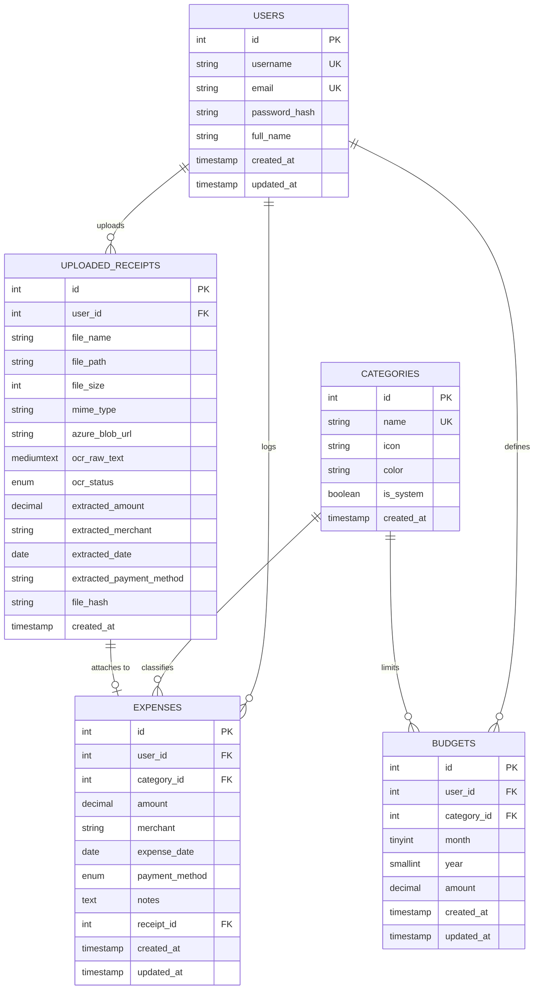
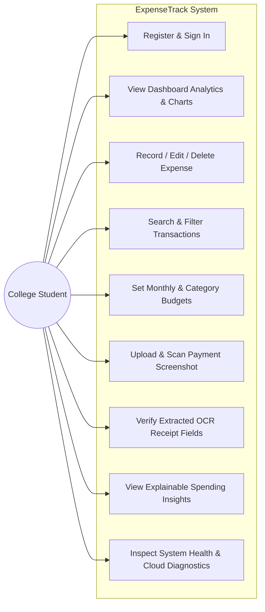
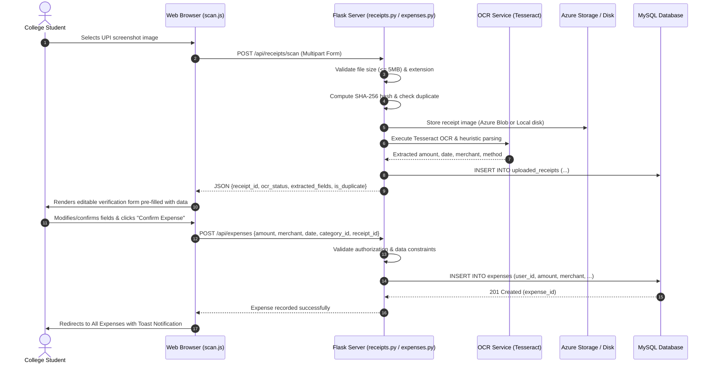

# ExpenseTrack – System Design & Architecture Specification

## 1. Executive Summary & Objective

**ExpenseTrack** is a secure, multi-tenant web application engineered for college students to track personal expenditures, enforce category and monthly budget thresholds, scan payment receipts via OCR, and receive deterministic rule-based spending recommendations.

---

## 2. Requirements Analysis

### 2.1 Functional Requirements (FR)
- **FR-01 Authentication & Multi-Tenancy:** Secure user registration, credential verification via salted Scrypt hashing, session establishment, and strict tenant isolation so users only access their own data.
- **FR-02 Expense Management (CRUD):** Record, view, update, filter, and delete expenses with monetary amounts (`DECIMAL(10,2)`), transaction dates, merchant details, payment methods (UPI, Card, Cash, etc.), and optional notes.
- **FR-03 Budget Tracking & Alerts:** Configure overall monthly caps and category-level limits; compute real-time utilization percentages with automated 80% caution alerts and 100% breach notifications.
- **FR-04 Smart Screenshot Scanning:** Upload payment screenshot images (PNG, JPG, WEBP <= 5MB), compute cryptographic SHA-256 digests for duplicate detection, extract financial entities via OCR when available, and present fields in a human-in-the-loop verification form.
- **FR-05 Deterministic Insights:** Derive explainable recommendations from factual database records (e.g., top spending categories, average daily burn rate, safe remaining daily allowance).

### 2.2 Non-Functional Requirements (NFR)
- **NFR-01 Security & Integrity:** Enforce parameterized queries to eliminate SQL injection, secure HTTPOnly session cookies, server-side authorization checks on every endpoint, and safe receipt access controls.
- **NFR-02 Reliability & Graceful Degradation:** Resilient fallback handling when optional components (such as Tesseract OCR or Azure Blob Storage) are unconfigured or unavailable on the host machine.
- **NFR-03 Performance & Scalability:** Indexed relational lookups on user IDs and date ranges, responsive sub-100ms API response times under standard single-node student loads.

---

## 3. High-Level Component Architecture

```mermaid
graph TD
    Client["Client Browser (HTML5 / Vanilla JS / Chart.js)"]
    
    subgraph "Flask Application Server (Python 3.14)"
        AuthRouter["Auth Router (/api/auth)"]
        ExpenseRouter["Expense Router (/api/expenses)"]
        BudgetRouter["Budget Router (/api/budgets)"]
        ReceiptRouter["Receipt Router (/api/receipts)"]
        InsightRouter["Insight Router (/api/insights)"]
        DiagRouter["Diagnostics Router (/api/system)"]
        
        SessionAuth["Session & Authorization Middleware"]
        OCRService["OCR & Heuristics Service"]
        InsightEngine["Rule-Based Insights Engine"]
        AzureStorage["Azure Blob / Local Storage Service"]
        DBLayer["PyMySQL Connection & Transaction Layer"]
    end

    subgraph "Data & Storage Tier"
        MySQL[("MySQL 8.0+ Database (expensetrack)")]
        DiskStorage[("Local Disk (uploads/receipts)")]
        AzureBlob[("Azure Blob Storage (Cloud / DP-900)")]
    end

    Client -->|HTTP / JSON API| AuthRouter
    Client -->|HTTP / JSON API| ExpenseRouter
    Client -->|HTTP / JSON API| BudgetRouter
    Client -->|Multipart Upload| ReceiptRouter
    Client -->|HTTP / JSON API| InsightRouter
    Client -->|HTTP / JSON API| DiagRouter

    AuthRouter & ExpenseRouter & BudgetRouter & ReceiptRouter & InsightRouter --> SessionAuth
    SessionAuth --> DBLayer
    ReceiptRouter --> OCRService
    ReceiptRouter --> AzureStorage
    InsightRouter --> InsightEngine
    InsightEngine --> DBLayer
    
    DBLayer -->|Parameterized SQL (Port 3306)| MySQL
    AzureStorage -->|Local Fallback| DiskStorage
    AzureStorage -.->|Cloud Blob SDK| AzureBlob
```

---

## 4. Entity-Relationship (ER) Diagram



---

## 5. Use Case Diagram



---

## 6. Expense Creation Sequence Diagram (Human-in-the-Loop OCR Workflow)



---

## 7. Scalability & Future Improvements

1. **Connection Pooling:** Upgrade PyMySQL standalone context to SQLAlchemy pool (`QueuePool`) for high-concurrency production deployments.
2. **Asynchronous Background OCR:** Offload heavy Tesseract image processing to Celery/Redis background worker queue when throughput exceeds 100 uploads/min.
3. **Azure Blob SAS Tokens:** Generate short-lived Shared Access Signatures (SAS) for private receipt downloads rather than streaming through web server processes.

