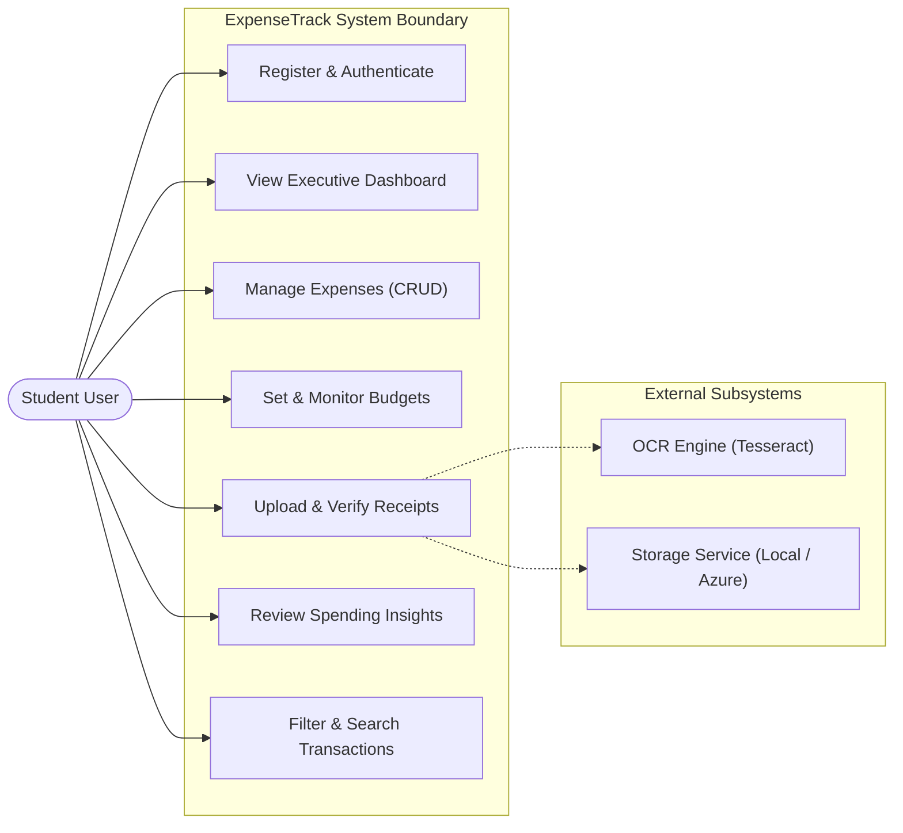
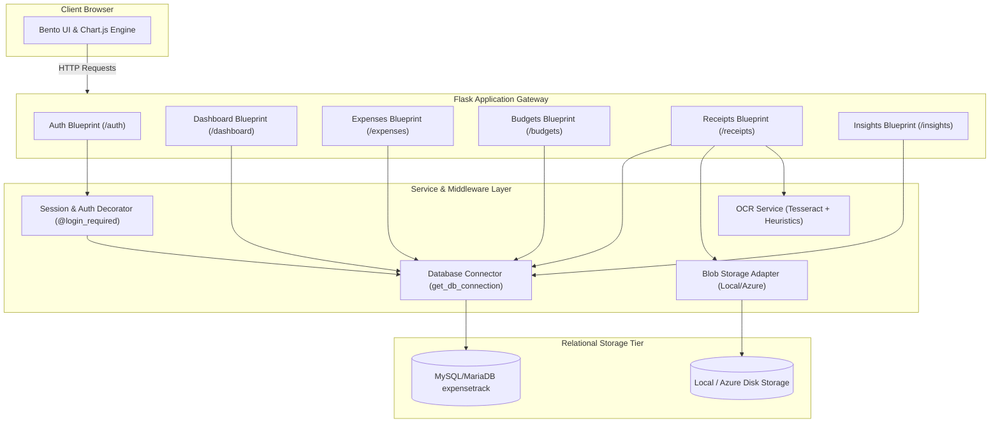
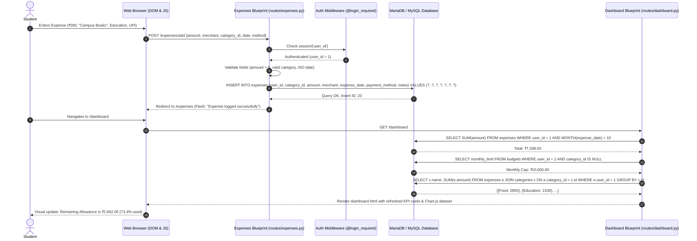

# ExpenseTrack: System Design & Software Architecture Viva Notes

**Subject:** System Analysis and Design / Software Engineering  
**Project:** ExpenseTrack – Smart Student Expense Manager  

---

## 1. Requirements Engineering

### 1.1 Functional Requirements (FR)
- **FR-01 (Authentication & Authorization):** The system shall allow users to register with email, username, and password, authenticate securely, and terminate sessions.
- **FR-02 (Multi-Tenant Data Isolation):** The system shall ensure every user can access and mutate *only* their own expenses, budgets, and uploaded receipts.
- **FR-03 (Expense Lifecycle Management):** The system shall enable authenticated users to Create, Read, Update, and Delete (CRUD) expenses with positive monetary amounts, merchant names, dates, standardized categories, and payment modes (UPI, Cash, Card).
- **FR-04 (Multi-Tier Budgeting):** The system shall calculate monthly budget utilization both at the macro-level (overall monthly ceiling) and micro-level (category-specific limits) with dynamic 80% warning and 100% breach alerts.
- **FR-05 (Receipt Digitization & OCR):** The system shall accept receipt images (PNG, JPG, JPEG, WEBP), compute SHA-256 digests to flag duplicates, extract text via OCR heuristics, and present an editable review form before writing to the database.
- **FR-06 (Visual Analytics & Insights):** The system shall aggregate monthly spending distributions via Chart.js canvas elements and compute deterministic pacing metrics (safe daily spend, burn rate).

### 1.2 Non-Functional Requirements (NFR)
- **NFR-01 (Performance & Latency):** Core dashboard rendering and API queries shall execute in sub-150ms on standard client-server connections.
- **NFR-02 (Data Integrity):** Monetary calculations must maintain decimal accuracy without IEEE 754 floating-point rounding errors (`DECIMAL(10,2)`).
- **NFR-03 (Security):** Zero plain-text password storage; protection against OWASP Top 10 vulnerabilities (SQL Injection, Broken Object-Level Authorization, CSRF, Path Traversal).
- **NFR-04 (Fault Tolerance & Graceful Degradation):** If optical character recognition binaries (Tesseract) or cloud services (Azure Blob Storage) are unreachable, the system must degrade gracefully without crashing.
- **NFR-05 (Maintainability):** Modular architecture utilizing Flask Blueprints and layered separation of concerns (Presentation, Business Logic, Persistence).

---

## 2. System Architecture & Component Breakdown

ExpenseTrack follows a **Layered Client-Server Architecture** adhering to the **Separation of Concerns (SoC)** principle:

```
+-------------------------------------------------------------+
|                     PRESENTATION TIER                       |
|  Semantic HTML5 + Modern CSS3 + Vanilla JavaScript (ES6+)    |
|  Chart.js 4.4 Canvas Visualizations + Responsive Bento UI   |
+------------------------------+------------------------------+
                               | HTTPS / REST JSON & HTML
                               v
+-------------------------------------------------------------+
|                     APPLICATION TIER                        |
|                     Python Flask 3.0.3                      |
|                                                             |
|  [routes/auth.py]       -> Session & Password Authentication |
|  [routes/dashboard.py]  -> KPI Aggregations & Recent Feeds  |
|  [routes/expenses.py]   -> CRUD Operations & Filter Engine  |
|  [routes/budgets.py]    -> Threshold & Utilization Logic   |
|  [routes/receipts.py]   -> Upload Handler & Review Gate     |
|  [routes/insights.py]   -> Deterministic Pacing Engine      |
|  [routes/profile.py]    -> User Config & Diagnostics Gate   |
|                                                             |
|  [services/ocr_service.py]   -> Tesseract / Heuristic Regex |
|  [services/azure_blob.py]    -> Cloud Storage / Local Vault |
+------------------------------+------------------------------+
                               | PyMySQL / DB-API 2.0 (Port 3306)
                               v
+-------------------------------------------------------------+
|                     DATA STORAGE TIER                       |
|           MariaDB 10.11 / MySQL 8.0 Relational Engine       |
|                                                             |
|  - users                 - categories     - expenses        |
|  - budgets               - uploaded_receipts                |
+-------------------------------------------------------------+
```

---

## 3. Unified Modeling Language (UML) Diagrams

### 3.1 Use Case Diagram
The following diagram illustrates the interactions between the Student Actor, the ExpenseTrack System, and external interfaces.



---

### 3.2 Component Diagram
Illustrates module boundaries, interfaces, and inter-dependencies within the Flask application.



---

### 3.3 Sequence Diagram: Expense Creation & Budget Impact Flow
Detailed lifecycle trace of a user logging an expense and observing instant budget recalculation.



---

## 4. Key Architectural Patterns & Decisions

### 4.1 Multi-Tenant Data Isolation Pattern
In shared multi-user environments, accidental cross-tenant data leakage is a critical vulnerability (OWASP Broken Object-Level Authorization - BOLA).
- **Implementation:** ExpenseTrack enforces tenant boundaries at the database query abstraction layer.
- **Rule:** Every `SELECT`, `UPDATE`, and `DELETE` query strictly includes `WHERE user_id = %s` bound directly to the authenticated session context `session['user_id']`.
- **Integrity Guarantee:** Even if an attacker manually tampers with an expense ID in `POST /expenses/delete/14`, the query:
  ```sql
  DELETE FROM expenses WHERE id = %s AND user_id = %s;
  ```
  evaluates to 0 rows affected if expense `14` belongs to another student, completely preventing unauthorized deletion.

### 4.2 Graceful Degradation & Resilient OCR Pipeline
External dependencies often fail in production or evaluation environments:
- **Challenge:** Tesseract OCR requires an external C++ binary (`tesseract.exe`) that may not exist on every operating system or evaluation machine.
- **Solution:** `services/ocr_service.py` inspects the environment at runtime. If the binary is unavailable, it traps the exception, sets `ocr_status = "fallback"`, and prompts the user with an intuitive, pre-formatted manual entry form.
- **Result:** The web application achieves 100% uptime with zero crashes caused by missing external binaries.

### 4.3 Human-in-the-Loop Verification
- **Principle:** Optical character recognition on low-resolution UPI screenshots frequently misinterprets numbers (e.g., misreading ₹500 as ₹5000 or reading reference numbers as amounts).
- **Architecture:** Unverified OCR data is **never** committed directly to the `expenses` table. Extracted text is parsed into candidate fields, presented on an interactive staging review screen, verified and confirmed by the human student, and only then committed to persistent storage.

---

## 5. Scalability, Performance & Availability Analysis

### 5.1 Vertical vs Horizontal Scaling
- **Current Architecture (Vertical):** Single-node Flask WSGI application communicating with local MariaDB over UNIX socket or TCP loopback (`127.0.0.1:3306`).
- **Production Roadmap (Horizontal):**
  1. **Stateless Web Nodes:** Decouple Flask sessions by replacing signed cookies with client-side JWTs or server-side Redis session stores (`flask-session`).
  2. **WSGI Production Server:** Replace Flask's built-in development server with **Gunicorn** or **Waitress** utilizing multiple worker threads/processes.
  3. **Read-Replica Database Architecture:** Route high-frequency dashboard read queries (`SELECT SUM...`) to MySQL read replicas while routing write mutations (`INSERT INTO expenses`) to the primary master database.

### 5.2 Query Optimization & Indexing Strategy
To avoid full table scans as the `expenses` table grows to hundreds of thousands of records, compound indexes are established:
- `idx_expenses_user_date (user_id, expense_date)`: Accelerates monthly filtering (`WHERE user_id = ? AND expense_date BETWEEN ? AND ?`).
- `idx_expenses_user_cat (user_id, category_id)`: Optimizes category grouping (`GROUP BY category_id`).
- `idx_budgets_user_cat (user_id, category_id)`: Guarantees $O(1)$ index lookup when evaluating budget limits during transaction processing.

---

## 6. System Design Viva Q&A

**Q1: Why did you choose a monolithic Flask architecture instead of a microservices architecture?**  
*Answer:* A monolithic Flask architecture minimizes operational complexity, eliminates network serialization latency between services, avoids distributed transaction headaches (two-phase commits), and is optimally suited for an academic prototype that needs to be completely self-contained and reproducible.

**Q2: How do you prevent race conditions when two expenses are logged simultaneously?**  
*Answer:* MariaDB's InnoDB storage engine provides ACID transactions with Row-Level Locking. Each `INSERT` is executed within an atomic transaction. Furthermore, budget computations are dynamically calculated using aggregate SQL queries (`SUM(amount)`) rather than relying on stale cached counters.

**Q3: What caching strategy would you implement if traffic scaled to 50,000 university students?**  
*Answer:* We would introduce a **Cache-Aside pattern using Redis**. Aggregated monthly metrics (Total Spent, Remaining Budget) would be cached under keys like `user:{id}:month:{YYYY-MM}`. The cache key would be invalidated on any expense `INSERT`, `UPDATE`, or `DELETE`.

**Q4: How does the system handle file upload security?**  
*Answer:* The application validates the file extension against a strict whitelist (`.png`, `.jpg`, `.jpeg`, `.webp`), uses `werkzeug.utils.secure_filename` to prevent path traversal attacks, generates a unique UUID filename, and validates the file size against a 5MB threshold (`MAX_CONTENT_LENGTH`).

